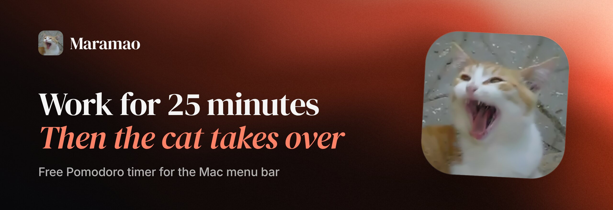
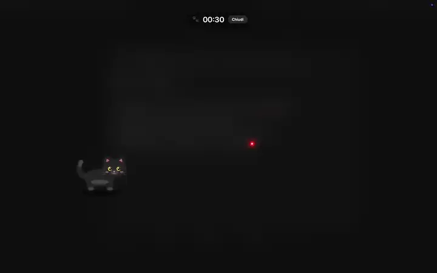
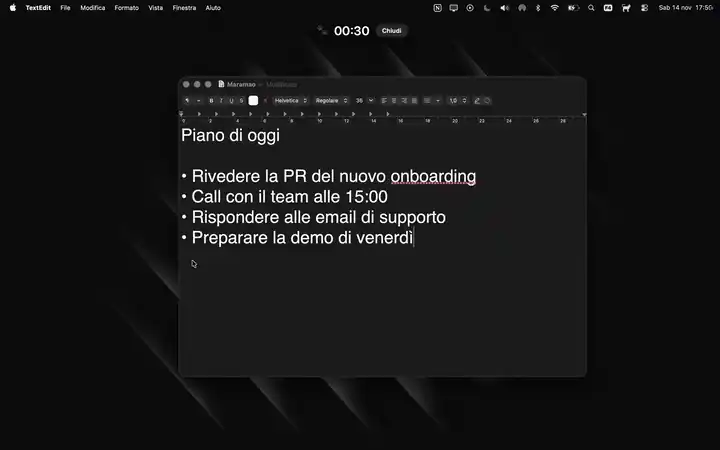
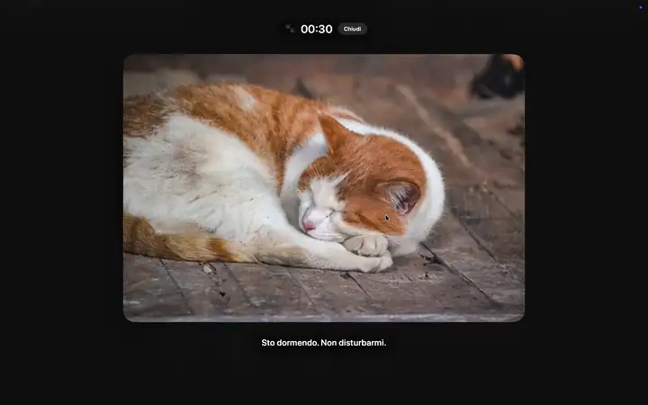

<p align="center">
  <a href="https://maramao.kkratter.com/"></a>
</p>

<p align="center">
  <a href="https://github.com/kkratterf/maramao/actions/workflows/ci.yml"></a>
  <a href="https://github.com/kkratterf/maramao/releases/latest"></a>
  
  
  <a href="#license"></a>
</p>

<p align="center">
  <a href="https://github.com/kkratterf/maramao/releases/latest"><b>Download for Mac</b></a>
  &nbsp;·&nbsp;
  <a href="https://maramao.kkratter.com/">Website</a>
  &nbsp;·&nbsp;
  <a href="#install">Other ways to install</a>
</p>

A native macOS menu bar app for the Pomodoro technique. Work for 25 minutes, then a cat makes sure you actually take the break. Written in Swift with SwiftUI and AppKit.

The app speaks Italian and English and follows the language of your Mac. This README uses the English labels; where it helps, the Italian one follows in parentheses.

**Install** (macOS 13+, free, no special permissions):

```bash
curl -fsSL https://raw.githubusercontent.com/kkratterf/maramao/main/install.sh | sh
```

or download the DMG from the [latest release](https://github.com/kkratterf/maramao/releases/latest), or use [Homebrew](#3-homebrew). Maramao is signed and notarized by Apple, so it opens like any other app.

---

## The cats

Pick one from **Mode** (*Modalità*) in the menu, or let **Surprise** (*Sorpresa*) choose a different one every break. **Try mode** (*Prova la modalità*), right under the list, plays the one you picked for 30 seconds.

<table>
  <tr>
    <td width="33%" valign="top">
      
      <h4>🔴 Laser chase<br><sub><i>Caccia al laser</i></sub></h4>
      Your pointer turns into a red laser dot and a cat chases it all over the screen, eyes locked on the dot. It pounces when the dot stops, beams when it catches it (hearts!) and frowns when it misses. Leave the mouse alone and it sits down to groom.
    </td>
    <td width="33%" valign="top">
      
      <h4>🐾 Cat invasion<br><sub><i>Invasione di gatti</i></sub></h4>
      Cats rain from the top of the screen, happy ones and grumpy ones, and pile up until everything is buried.
    </td>
    <td width="33%" valign="top">
      
      <h4>😴 Don't wake the cat<br><sub><i>Non svegliare il gatto</i></sub></h4>
      A big photo of a sleeping cat over your blurred screen. Touch the mouse or the keyboard and an angry cat glares at you, with a passive-aggressive remark underneath ("Can't stay away from the computer for 5 minutes?"). Leave everything alone and it falls asleep again. Each break brings a new pair of cats.
    </td>
  </tr>
</table>

The cats meow, growl and purr with real recorded voices.

During a break the screen behind the cats is blurred and dimmed, like behind a Mac dialog, and the only control is a small pill: a paw, the countdown and **Close** (*Chiudi*), which shows up once the break may be skipped (after a minute). Not to be confused with **Turn off for…** (*Disattiva per*) in the menu, which puts the whole app to sleep for a while.

Switching rhythm takes one click: **Rhythm** (*Ritmo*) in the menu offers **Classic 25/5**, **Long 50/10** (long break 30) and **Deep 90/20** (long break 30). The session on screen keeps its length; the new rhythm starts with the next phase.

### Calls and presentations

A cat on your Zoom call is not funny. When the microphone or the camera is in use, or Keynote, PowerPoint, a video or a call app is fullscreen, the break waits one minute at a time (up to 10 minutes by default, or as long as it takes) and a little cat tells you "I'll wait until your call is over". No permission needed.

### When you step away

Lunch, a meeting, the Mac asleep or locked: Maramao notices (no permission needed). By default the work timer stops while you are away, and if you were gone at least as long as a short break you come back to a fresh start, because you already rested. Either way, a break never starts while the screen is locked or asleep, and never in the first seconds after you are back.

### Emergency exit

If a break ever gets stuck, or you really have to stop it, press **⌃⌥⌘⌫** (Control-Option-Command-Delete) to end it right away, **strict mode included**. No shortcut at hand? Click five times quickly in the **top-left corner** of any screen. Neither needs any permission.

As a safety net, Maramao also closes every cat window by force if a break is still on screen 30 seconds after it should have ended.

### Keyboard shortcuts

They work from any app and need no special permission.

| Shortcut | Action |
| --- | --- |
| ⇧⌘M | Start a pomodoro, or pause / resume it. A small bubble under the cat in the menu bar confirms what happened |
| ⌃⌥⌘B | Take the cat break now |
| ⌃⌥⌘S | Skip the current phase (a break only once skipping is allowed) |
| ⌃⌥⌘R | Snooze the break that just started: the cat comes back a few minutes later (up to 3 times a day) |

A global shortcut wins over the app in front, so while Maramao runs ⇧⌘M no longer reaches Teams (mute), Slack or VS Code.

### Automation

Drive Maramao from Shortcuts, Siri, Raycast, Alfred, a Stream Deck or the terminal with `maramao://` URLs.

<details>
<summary>Show the details</summary>

Maramao answers to `maramao://` URLs, so Shortcuts ("Open URLs"), Raycast, Alfred, a Stream Deck or the terminal can drive it:

```bash
open maramao://start
```

| URL | What it does |
| --- | --- |
| `maramao://start` | Start a pomodoro (or resume a paused one) |
| `maramao://pause` | Pause the running pomodoro |
| `maramao://resume` | Resume a paused pomodoro |
| `maramao://toggle` | Start, pause or resume, like the main button |
| `maramao://break` | Take the cat break now |
| `maramao://skip` | Skip the current phase |
| `maramao://reset` | Stop and go back to idle |
| `maramao://mode/<id>` | Choose the break mode for the next breaks |
| `maramao://longmode/<id>` | Choose the break mode of the long break (`same` follows the short break) |
| `maramao://preview/<id>` | Try a break mode for 30 seconds |
| `maramao://preset/<id>` | Choose the rhythm: `classic`, `long`, `deep` or `custom` |

Mode ids: `laserChase`, `catPile`, `sleepyCat`, or `random` (Surprise). URLs that would end a break early (`start`, `skip`, `reset`) only work once the break may be skipped, so **strict mode** still wins.

The **Shortcuts** app also lists Maramao actions: *Start a pomodoro*, *Pause or resume*, *Cat break now*, *Choose the break mode*, *Choose the rhythm*, *Choose the long-break cat* and *Maramao status* (returns the phase, the time left and today's pomodori as text). Siri and Spotlight know phrases like "Start a pomodoro with Maramao" (in Italian: "Inizia un pomodoro con Maramao"). They show up once `Maramao.app` has been opened from `Applications`.

A Raycast script command, for example:

```bash
#!/bin/bash
# @raycast.schemaVersion 1
# @raycast.title Maramao: start / pause
# @raycast.mode silent
open "maramao://toggle"
```

</details>

### Cat packs

Add your own fur colours for the drawn cats with a folder and a `pack.json`, no code needed.

<details>
<summary>Show the details</summary>

A cat pack adds your own cats without touching the code: fur colours for the drawn cats in **Laser chase** and **Cat invasion**. Packs are plain folders in `~/Library/Application Support/Maramao/Cats/`, loaded when Maramao starts. To start, copy [`packs/example`](packs/example) there. The format also has cat names, meme captions, pictures and tips: they are still accepted, but no mode shows them any more.

```
Cats/
  my-cats/
    pack.json
    images/micio.png
```

`pack.json` (only `schemaVersion`, `id`, `name` and `license` are required):

```json
{
  "schemaVersion": 1,
  "id": "my-cats",
  "name": "My cats",
  "author": "Your name",
  "license": "CC0-1.0",
  "description": "Optional, up to 300 characters.",
  "palettes": [
    { "name": "Micio", "fur": "#F0963C", "stripes": "#C8641E", "belly": "#FAE6C8", "eyes": "#6EBE50", "nose": "#F28C99" }
  ],
  "catNames": ["Micio"],
  "captions": [{ "top": "WHEN THE TIMER RINGS", "bottom": "AND THE CAT SMILES" }],
  "images": ["images/micio.png"],
  "tips": { "short": ["Look away for twenty seconds."], "long": ["Go for a short walk."] }
}
```

Rules, checked when the pack loads (a pack that breaks one is skipped; it never stops a break):

- `license` is `CC0-1.0` or `CC-BY-4.0`; CC-BY needs an `author`. Only art you made or that is under one of these licenses.
- `id`: lower-case letters, digits and dashes, up to 40 characters. Colours are `#RRGGBB`; `stripes` and `nose` are optional.
- `images` are PNG, GIF or JPEG files **inside the pack folder**: no web addresses, no `..`, at most 5 MB each, 50 images and 30 MB per pack.
- Text limits: names 30 characters, captions 80 per line, tips 160; at most 16 palettes, 50 names, 200 captions, 100 tips per kind. `pack.json` up to 256 KB.

</details>

---

## Install

Maramao needs **macOS 13 Ventura or later** and no special permissions. Pick one of the three ways below.

### 1. The DMG (drag and drop)

1. Download `Maramao-x.y.z.dmg` from the [latest release](https://github.com/kkratterf/maramao/releases/latest).
2. Open it and drag the cat onto **Applications**.
3. Eject the disk image.

Every release also ships a plain `Maramao-x.y.z.zip` and a `SHA256SUMS.txt` to check the downloads (`shasum -a 256 -c SHA256SUMS.txt --ignore-missing`).

### 2. The one-liner

```bash
curl -fsSL https://raw.githubusercontent.com/kkratterf/maramao/main/install.sh | sh
```

The script downloads the latest release, checks its SHA-256, quits Maramao if it is running, installs `Maramao.app` in `/Applications` (or `~/Applications` if `/Applications` is not writable), and offers to open it. Read it first if you like: it is [short](install.sh).

| Variable | Effect |
| --- | --- |
| `MARAMAO_VERSION=v0.1.0` | install a specific release instead of the latest |
| `MARAMAO_INSTALL_DIR=~/Apps` | install somewhere else |
| `MARAMAO_NO_OPEN=1` | do not offer to open Maramao at the end |

Variables go after the pipe: `curl -fsSL .../install.sh | MARAMAO_VERSION=v0.1.0 sh`.

### 3. Homebrew

```bash
brew tap kkratterf/maramao https://github.com/kkratterf/maramao
brew install --cask maramao
```

The tap lives in this repository (`Casks/maramao.rb`) and is updated by every release. The cask installs the DMG from GitHub Releases into `/Applications`.

### 4. First launch and Gatekeeper

Since 0.8.0 every release is signed with a Developer ID and notarized by Apple, with the ticket stapled to the app and the DMG, so macOS opens it without asking anything.

Versions up to 0.7.0 were not notarized. If macOS says it cannot verify an old copy, install the latest release, or open it anyway from **System Settings → Privacy & Security → Open Anyway**.

### 5. Where is it?

Maramao lives in the **menu bar**, top right: look for the cat (a countdown appears next to it while you work). There is no Dock icon. The first time you open it, a cat welcomes you in a small window: it sets the timer, lets you pick a cat, shows a 10-second trial break and the emergency exit, and can turn on **Open Maramao at login**. If the menu bar is too full and the notch hides the cat, open Maramao again from Applications or Spotlight and its menu opens where your pointer is.

The menu is a plain macOS menu, laid out like the Timer in the Clock app. On top, a line says what the timer is doing (*Al lavoro · 18:32*), followed by the controls: **Start timer** (*Avvia timer*), **Pause timer** (*Sospendi timer*) or **Resume timer** (*Riprendi timer*) on ⇧⌘M, **Stop timer** (*Interrompi timer*), which goes back to the start, and **Take the cat break now** (*Fai la pausa gatto adesso*). Below, each in its own section: the modes, **Try mode**, **Rhythm**, **Turn off for…** (*Disattiva per*), updates and **Quit Maramao** (*Esci da Maramao*).

### 6. Updating

Maramao updates itself: it checks once a day and asks before installing. To check right now, choose **Check for Updates…** (*Controlla aggiornamenti…*) in the menu. You can also install a new version by hand the same way as the first time: drag the new DMG's app over the old one (choose **Replace**), or run the one-liner again. Your settings are kept.

With Homebrew: `brew update && brew upgrade --cask --greedy maramao` (the cask is marked `auto_updates`, so a plain `brew upgrade` leaves Maramao alone and lets the app update itself).

### 7. Uninstalling

```bash
curl -fsSL https://raw.githubusercontent.com/kkratterf/maramao/main/install.sh | sh -s -- --uninstall
```

With Homebrew: `brew uninstall --cask maramao`, or `brew uninstall --zap --cask maramao` to remove the settings too.

The script quits Maramao, deletes `Maramao.app` and its settings (`defaults delete com.kkratterf.maramao`). By hand: quit Maramao from its menu, move `Maramao.app` to the Bin, and optionally run that `defaults delete` command. The login item, if you turned it on, goes away with the app.

### 8. Build from source

Needs Xcode 15 or later.

```bash
git clone https://github.com/kkratterf/maramao
cd maramao
swift test                      # unit tests
scripts/build-app.sh release    # builds dist/Maramao.app
open dist/Maramao.app
```

`swift run Maramao` also works for a quick try, without the app bundle.

---

## Contributing

Contributions are welcome, from a new cat to a timer fix.

- **Found a bug or have an idea?** [Open an issue](https://github.com/kkratterf/maramao/issues/new/choose): there are forms for bugs, features and new break concepts.
- **Want to add a cat?** Every break mode is a `BreakMode` in `Sources/Maramao/Modes/`. The shared `CatView` draws the cat, `OverlayWindow` and `BreakHUD` do the rest.
- **Made a cat pack?** Share it by pull request: add it as `packs/<id>/` (the folder name must match the `id`) with a `pack.json` that declares `CC0-1.0` or `CC-BY-4.0` and only art you have the right to share under it. `swift test` validates every pack in `packs/`, so CI tells you if something is off.
- **Before a PR**, read [`AGENTS.md`](AGENTS.md): it lists the checks to run, the commit format and the rules for break modes. It is written for AI agents and humans alike.

---

## Art

The logo and app icon are a frame of [Yawning kitten.ogv](https://commons.wikimedia.org/wiki/File:Yawning_kitten.ogv) by Andrew Krizhanovsky (public domain), built by `scripts/make-logo.py`.

The cats in **Laser chase** and **Cat invasion** are drawn in code (`Sources/Maramao/Shared/CatView.swift`).

**Don't wake the cat** shows photos from the [WordPress Photo Directory](https://wordpress.org/photos/), all released under [CC0](https://creativecommons.org/publicdomain/zero/1.0/). They are not committed: `scripts/build-app.sh` downloads them, shrinks them and copies them into the app. The list, with each photo's page and author, is [`Resources/cat-photos.tsv`](Resources/cat-photos.tsv). Thanks to Brandon Zhang, Julia Golomb, mdburnette, 渡邉厚夫, Taco Verdonschot, Sakib MD Nazmush, Midhun P, Noelia Segura and Yam B Chhetri.

The cats' meows, growls and purrs are recordings by Joseph Sardin from [BigSoundBank](https://bigsoundbank.com/), released under [CC0](https://creativecommons.org/publicdomain/zero/1.0/). Like the photos they are not committed: `scripts/build-app.sh` downloads them and copies them into the app, which trims the silence around each one, brings them all to the same loudness and loops the purr without a gap. The list is [`Resources/cat-sounds.tsv`](Resources/cat-sounds.tsv).

The [website](https://maramao.kkratter.com/) shows screen recordings of the app itself in `site/media/mode-*.mp4`, and the yawning kitten clip that the logo comes from in `site/media/outro.mp4`. The mode previews in this README are made from those recordings by `scripts/make-readme-previews.sh`, and the banner by `scripts/render-og.mjs`.

The pictures in `packs/example/images` were drawn for this repository by a small script and are CC0, like the rest of that pack. Community packs declare their own license (CC0 or CC-BY) in `pack.json`.

---

## License

MIT

---

<p align="center">
  <b>Made with Claude and cats</b>
</p>
